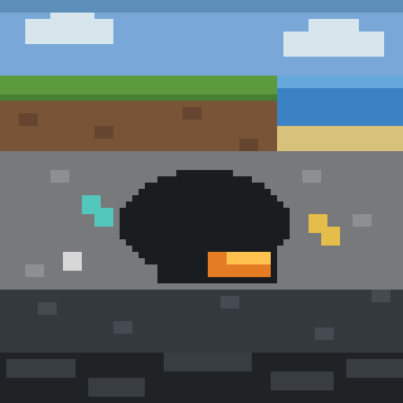
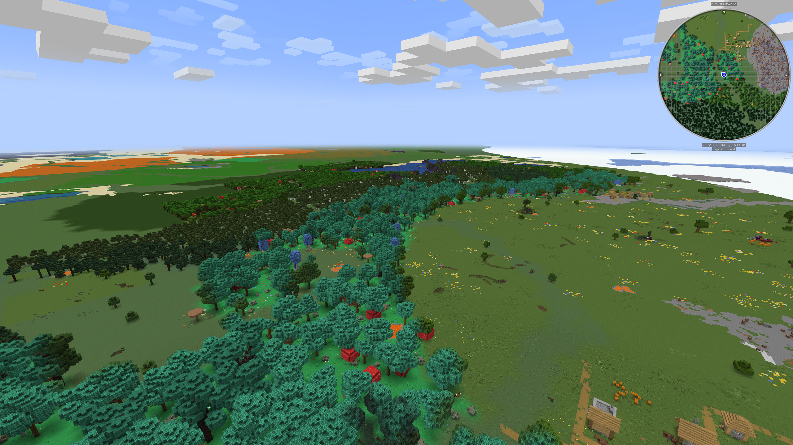
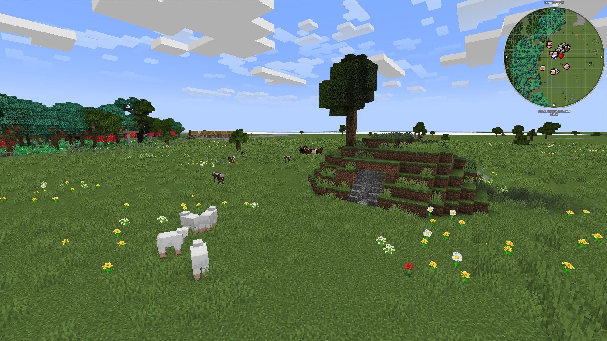
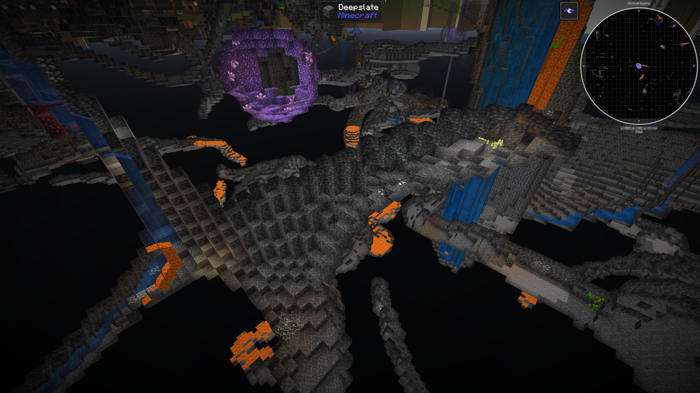

# Flat Strata



**A flat world that still feels like Minecraft.**

Flat Strata adds a new overworld preset with fixed terrain layers while preserving biomes, caves, ores, fluids, vegetation, and structures. It is designed for Minecraft 1.21.1 modpacks running NeoForge.

[Русское описание](README.ru.md)



## Features

- Flat land at a fixed height with biome-appropriate surface blocks.
- Fixed ocean floors and sea level.
- Water-filled rivers with gravel beds, clay deposits on the bed and lower banks, and frozen rivers with an ice surface.
- Smoothed surface biome borders without blocky 4×4 surface transitions.
- Vanilla-style caves below a protected surface crust.
- Dripstone and lush caves kept underground, with deep dark reserved for the lowest levels.
- Ores, ore veins, underground water, and lava.
- Villages, mineshafts, strongholds, and other structures.
- Strict structure validation: surface structures cannot cross biome boundaries or unsupported cavities, and underground structures cannot break through the surface.
- Standard `minecraft:noise` terrain generation and `multi_noise` biome selection.
- Modded worldgen features can use the standard generation stages and NeoForge biome modifiers.
- The Nether and the End keep their normal generation.

Existing worlds are not changed. The preset applies only when creating a new world. Strict structure filtering can reduce the number of structures near biome borders.

## Fixed layers

| Layer | Height |
|---|---:|
| Land surface | `Y=63` |
| Dirt or sand sublayer | `Y=60–62` |
| Desert sandstone | `Y=57–59` |
| River water / frozen river ice | `Y=59–62` / `Y=62` |
| River gravel bed | `Y=58` |
| Coastal floor | `Y=55` |
| Deep ocean floor | `Y=54` |
| Highest water block | `Y=62` |
| Caves | Below `Y=50` |
| Deepslate | `Y=0` and below |
| Bedrock | `Y=-64` |

Badlands, snowy biomes, and other special surface types retain their biome-specific materials.

## Requirements

- Minecraft **1.21.1**
- NeoForge **21.1.267 or newer**
- Java **21**

## Usage

1. Install the JAR on both the client and server when playing on a dedicated server.
2. Start creating a new world.
3. Open **More World Options**.
4. Select **Flat Strata** / **Плоские слои** as the world type.

## Gallery

### Flat surface with vegetation and wildlife



### Caves, ores, fluids, and underground structures



## Building

```bash
./gradlew build
```

The release JAR is written to `build/libs/flatstrata-1.2.1.jar`.

## Links

- [Source code](https://github.com/Traineratwot/FlatStrata)
- [Issue tracker](https://github.com/Traineratwot/FlatStrata/issues)
- [Publishing notes](PUBLISHING.md)

Licensed under the [MIT License](LICENSE).
