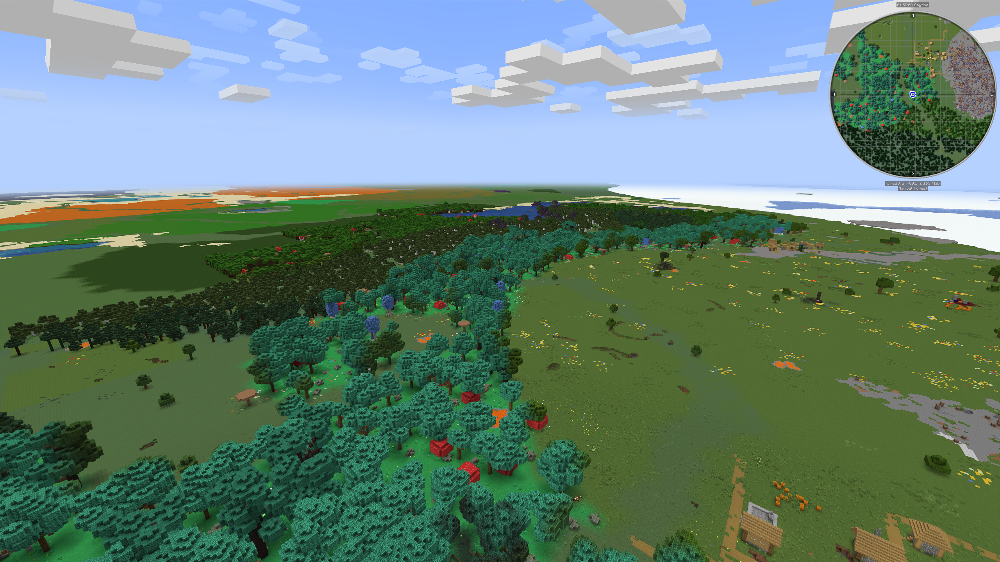
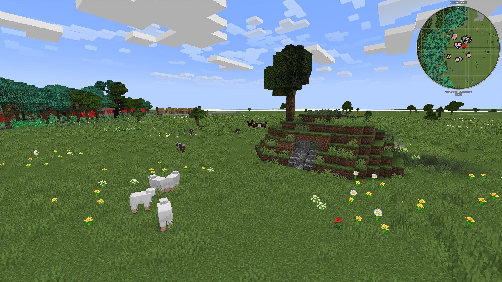
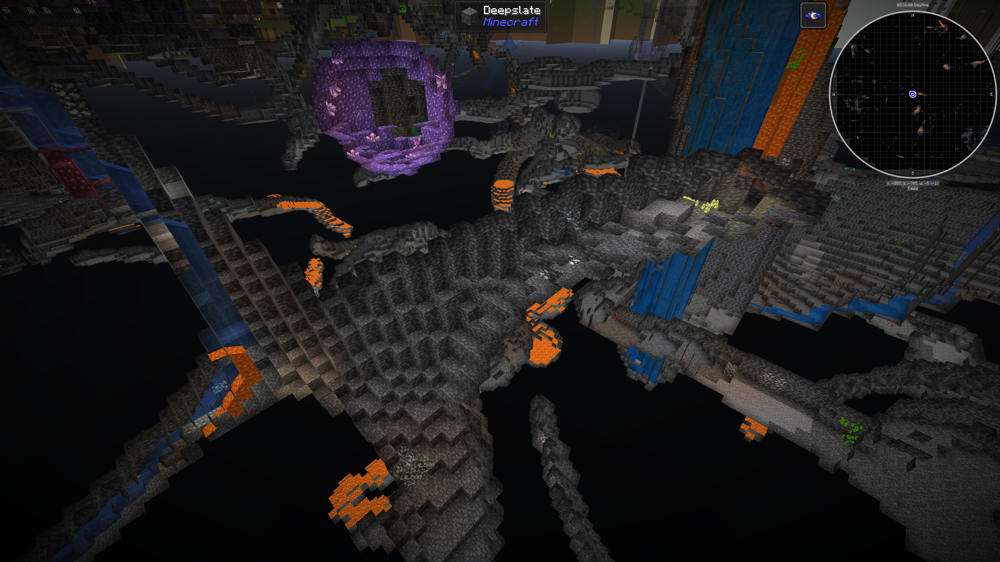

# Flat Strata

**Плоский мир, который сохраняет обычную генерацию Minecraft.**

Flat Strata добавляет новый тип мира **«Плоские слои»** с фиксированной высотой поверхности, биомами, пещерами, рудами, жидкостями, растительностью и структурами. Отдельные сборки поддерживают NeoForge 1.21.1, Forge 1.20.1 и Fabric 1.20.1.



## Возможности

- плоская суша с материалами поверхности, соответствующими биому;
- фиксированные уровни океанического дна и воды;
- реки с водой, гравийным руслом и залежами глины на дне и нижних стенах, а также покрытые льдом frozen rivers;
- сглаженные границы поверхностных биомов без квадратных переходов 4×4;
- пещеры под защищённым поверхностным слоем;
- dripstone и lush caves только под землёй, deep dark на самых нижних уровнях;
- руды, рудные жилы, подземная вода и лава;
- деревни, шахты, крепости и другие структуры;
- строгая проверка структур: наземные не пересекают границы биомов и полости в опорной зоне, а подземные не выходят на поверхность;
- стандартные `minecraft:noise` и `multi_noise` для совместимости с модовой генерацией;
- обычные Нижний мир и Энд.

Существующие миры не изменяются. Пресет применяется только при создании нового мира. Из-за строгой фильтрации возле границ биомов может появляться меньше структур.

## Уровни генерации

| Слой | Высота |
|---|---:|
| Поверхность суши | `Y=63` |
| Земля или песок | `Y=60–62` |
| Песчаник в пустыне | `Y=57–59` |
| Вода в реках / лёд в frozen rivers | `Y=59–62` / `Y=62` |
| Гравийное русло реки | `Y=58` |
| Прибрежное дно | `Y=55` |
| Глубокое океаническое дно | `Y=54` |
| Верхний блок воды | `Y=62` |
| Пещеры | Ниже `Y=50` |
| Глубинный сланец | `Y=0` и ниже |
| Коренная порода | `Y=-64` |

Для бадлендсов, снежных и других особых биомов сохраняются их собственные материалы поверхности.

## Поддерживаемые версии

| Загрузчик | Minecraft | Java | Файл |
|---|---|---:|---|
| NeoForge 21.1.267+ | 1.21.1 | 21 | `flatstrata-1.3.0.jar` |
| Forge 47.4.20+ | 1.20.1 | 17 | `flatstrata-1.20.1-forge-1.3.0.jar` |
| Fabric Loader 0.16.10+ | 1.20.1 | 17 | `flatstrata-1.20.1-fabric-1.3.0.jar` |

Выбирай JAR, соответствующий и версии Minecraft, и загрузчику. Файлы для разных загрузчиков несовместимы между собой.

## Использование

1. Установи JAR на клиент и сервер.
2. Начни создавать новый мир.
3. Открой **«Дополнительные настройки мира»**.
4. Выбери тип мира **«Плоские слои»**.

## Скриншоты

### Поверхность, растительность и животные



### Пещеры, руды, жидкости и подземные структуры



## Сборка

```bash
./gradlew build
cd forge-1.20.1 && ./gradlew build
cd ../fabric-1.20.1 && ./gradlew build
```

Файлы появляются в `build/libs` соответствующего модуля. GitHub Actions собирает все три загрузчика независимо.

Лицензия: [MIT](LICENSE).
