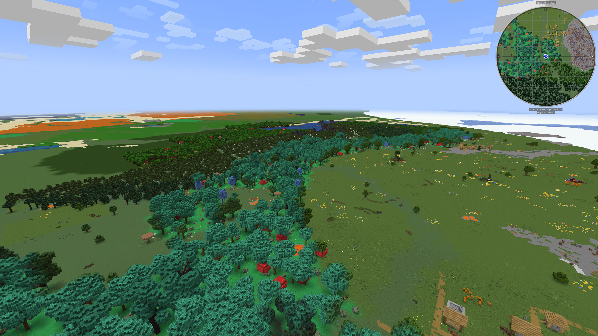
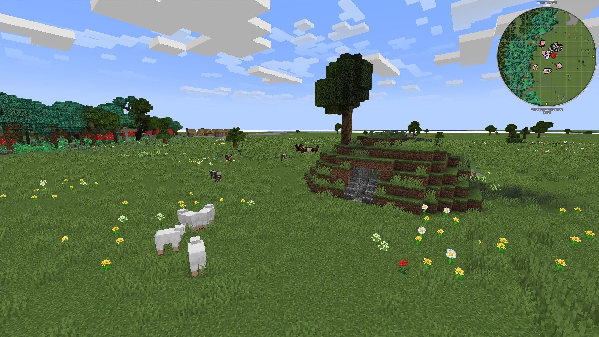
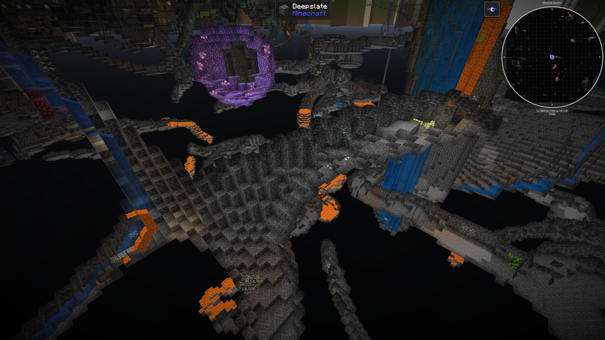

# Flat Strata

**A flat world that still feels like Minecraft.**

Flat Strata adds a new overworld preset with fixed terrain layers while preserving biomes, caves, ores, fluids, vegetation, and structures. It is designed for Minecraft 1.21.1 modpacks running NeoForge.

## Features

- Flat land at `Y=63` with biome-appropriate surface blocks.
- Three-block dirt or sand sublayers and fixed desert sandstone layers.
- Coastal and deep ocean floors at fixed heights, with water up to `Y=62`.
- Vanilla-style caves below `Y=50`, protected from breaking through the flat surface.
- Ores, ore veins, underground water, and lava.
- Villages, mineshafts, strongholds, and other structures.
- Biome-specific materials for badlands, snowy biomes, and other special surfaces.
- Normal Nether and End generation.

## Designed for modpacks

Flat Strata uses the standard `minecraft:noise` chunk generator and `multi_noise` biome selection instead of replacing the entire worldgen pipeline. Modded worldgen features can use standard generation stages and NeoForge biome modifiers.

Compatibility with a specific mod still depends on how that mod implements its terrain, biomes, or structures.

## Fixed layers

| Layer | Height |
|---|---:|
| Land surface | `Y=63` |
| Dirt or sand sublayer | `Y=60–62` |
| Desert sandstone | `Y=57–59` |
| Coastal floor | `Y=55` |
| Deep ocean floor | `Y=54` |
| Highest water block | `Y=62` |
| Caves | Below `Y=50` |
| Deepslate | `Y=0` and below |
| Bedrock | `Y=-64` |

## Requirements

- Minecraft **1.21.1**
- NeoForge **21.1.267 or newer**
- Java **21**

Install the JAR on both the client and server when playing on a dedicated server.

## Usage

1. Start creating a new world.
2. Open **More World Options**.
3. Select **Flat Strata** as the world type.

Existing worlds are not changed. The preset applies only when creating a new world.

## More screenshots

## Source and support

- [Source code](https://github.com/Traineratwot/FlatStrata)
- [Issue tracker](https://github.com/Traineratwot/FlatStrata/issues)
- [Russian README](https://github.com/Traineratwot/FlatStrata/blob/main/README.ru.md)

Licensed under MIT.
